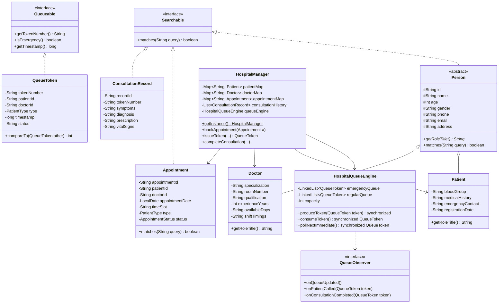
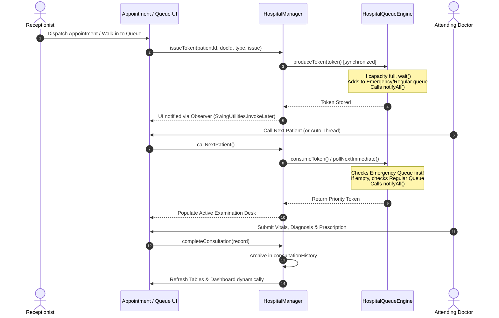

# ACADEMIC PROJECT REPORT
## Project-Based Learning (PBL) in Advanced Java Programming

---

# HOSPITAL APPOINTMENT AND PATIENT QUEUE MANAGEMENT SYSTEM
### *A Multi-Threaded, Priority-Driven Clinical Desktop Application*

**Course:** Advanced Java Programming  
**Domain:** Healthcare Systems & Desktop Application Development  
**Technology Stack:** Java SE, Java Swing (GUI), Multi-threading (Producer–Consumer), Java Collections Framework  
**Operating Environment:** Cross-platform (Windows, Linux, macOS)  

---

## TABLE OF CONTENTS
1. [Abstract](#1-abstract)
2. [Introduction & Problem Statement](#2-introduction--problem-statement)
3. [Objectives & Project Scope](#3-objectives--project-scope)
4. [System Architecture & UML Design](#4-system-architecture--uml-design)
5. [Advanced Java Technical Implementation](#5-advanced-java-technical-implementation)
   - 5.1 Object-Oriented Programming (OOP) Mapping
   - 5.2 Java Collections Framework
   - 5.3 Multi-Threading & Producer–Consumer Pattern
   - 5.4 Robust Exception Handling
   - 5.5 Swing Event Dispatch Thread (EDT) Responsiveness
6. [Module Description & Functional Workflow](#6-module-description--functional-workflow)
   - 6.1 Dashboard & Live KPI Analytics
   - 6.2 Patient Record Management
   - 6.3 Doctor & Specialty Directory
   - 6.4 Appointment Scheduling & Conflict Resolution
   - 6.5 Dual-Priority Queue Management
   - 6.6 Consultation Desk & Medical Record Generation
7. [Testing, Verification & Quality Assurance](#7-testing-verification--quality-assurance)
8. [Demonstration & Viva Voce Guide](#8-demonstration--viva-voce-guide)
9. [Conclusion & Future Enhancements](#9-conclusion--future-enhancements)
10. [References](#10-references)

---

## 1. ABSTRACT

In contemporary outpatient healthcare facilities, patient queue mismanagement and appointment scheduling conflicts often lead to prolonged wait times, patient dissatisfaction, and clinical delays during medical emergencies. This project presents the **Hospital Appointment and Patient Queue Management System**, a standalone desktop application developed using **Java Swing** and pure **Java Standard Edition (SE)**.

The system addresses two major clinical workflows: scheduled outpatient appointments and acute walk-in queue triage. By employing the **Producer–Consumer** concurrent design pattern, receptionists and dispatchers act as producers generating prioritized consultation tokens, while attending doctors act as consumers retrieving tokens. A thread-safe queue engine coordinates separate Emergency and Regular queues using Java intrinsic monitor synchronization (`synchronized`, `wait()`, `notifyAll()`), ensuring emergency cases receive strict, non-preemptive service priority. Furthermore, robust OOP principles, custom exception hierarchies, and the Java Collections Framework (`LinkedHashMap`, `LinkedList`, `ArrayList`) ensure seamless data lookup, duplicate-booking prevention, and dynamic UI updates without freezing the user interface.

---

## 2. INTRODUCTION & PROBLEM STATEMENT

### 2.1 Background & Motivation
Traditional hospital reception desks frequently suffer from manual paperwork, disjointed appointment books, and lack of prioritized triage for walk-in patients experiencing severe symptoms. A medical facility requires:
1. Real-time visibility into active patient inflow.
2. Conflict-free appointment booking that prevents double-booking specialists.
3. An automated triage queue where life-threatening emergencies bypass regular checkup queues safely.
4. Seamless transition of patients from arrival to medical examination and prescription generation.

### 2.2 Problem Statement
To engineer a clean, responsive, and robust desktop hospital management system utilizing Java Swing and Advanced Java concepts that eliminates duplicate bookings, enforces strict priority queuing through multi-threaded synchronization, and delivers dynamic real-time updates across clinical modules.

---

## 3. OBJECTIVES & PROJECT SCOPE

### 3.1 Primary Objectives
- **Modern Graphical User Interface:** Construct an intuitive desktop application utilizing a clean clinical theme (Navy Blue, Medical White, Soft Sky Blue).
- **Core Clinical Modules:** Deliver six fully integrated modules: Dashboard, Patient Management, Doctor Management, Appointment Scheduling, Priority Queue Management, and Consultation Examination.
- **Concurrent Queue Engine:** Implement a multi-threaded Producer–Consumer architecture using Java threads, monitors, `wait()`, and `notifyAll()`.
- **Priority Dispatch:** Maintain separate queues for Emergency and Regular patients, ensuring immediate priority for emergency cases.
- **Data Integrity & Validation:** Detect and handle scheduling conflicts and duplicate doctor appointments with custom checked exceptions.
- **Dynamic Updates:** Reflect real-time data modifications across all panels instantly via an Observer design pattern.

### 3.2 Project Scope
- Desktop environment running under Java SE (compatible with Java 17 LTS, Java 21 LTS, and Java 25).
- Zero external third-party library dependencies (100% native Java SE and Swing APIs), ensuring instant portability.

---

## 4. SYSTEM ARCHITECTURE & UML DESIGN

### 4.1 High-Level Architecture
The system adopts a layered architecture separating Presentation (Swing UI Components and Panels), Business Logic & Services (`HospitalManager`), Concurrency Control (`HospitalQueueEngine`), and Domain Models (`Person`, `Patient`, `Doctor`, `Appointment`, `QueueToken`, `ConsultationRecord`).

```
+-------------------------------------------------------------+
|                 PRESENTATION LAYER (SWING)                  |
|  MainFrame | Dashboard | Patient | Doctor | Appt | Queue    |
+-------------------------------------------------------------+
                              |
+-------------------------------------------------------------+
|                     SERVICE LAYER                           |
|       HospitalManager (Singleton Business Controller)       |
+-------------------------------------------------------------+
            |                                    |
+-----------------------+            +------------------------+
|   CONCURRENCY LAYER   |            |      DATA & DOMAIN     |
|  HospitalQueueEngine  |            |   Collections: Maps,   |
| (Producer-Consumer,   |            |   Lists, Priority Queues   |
|   wait/notifyAll)     |            | Models: Patient/Doctor |
+-----------------------+            +------------------------+
```

### 4.2 UML Class Diagram



### 4.3 Sequence Diagram: Appointment Dispatch & Queue Consultation



---

## 5. ADVANCED JAVA TECHNICAL IMPLEMENTATION

### 5.1 Object-Oriented Programming (OOP) Principles
1. **Abstraction:**
   - Abstract superclass `Person` defines foundational attributes (`id`, `name`, `age`, `phone`, etc.) and abstract method `getRoleTitle()`.
   - High-level interfaces `Searchable`, `Queueable`, and `QueueObserver` decouple operations from specific class implementations.
2. **Inheritance:**
   - `Patient extends Person`: Adds clinical data like `bloodGroup`, `medicalHistory`, and `emergencyContact`.
   - `Doctor extends Person`: Adds professional qualifications, `specialization`, and `roomNumber`.
3. **Polymorphism:**
   - Method overriding: Custom implementations of `matches(String query)` in `Person`, `Patient`, `Doctor`, and `Appointment` for multi-criteria searching.
   - Dynamic token prioritization via `Comparable<QueueToken>`.
4. **Encapsulation:**
   - All class members are encapsulated with `private` or `protected` visibility and accessed through type-safe getters and setters with validation.

### 5.2 Java Collections Framework
- **`LinkedHashMap<String, Entity>`:** Utilized in `HospitalManager` for `patientMap`, `doctorMap`, and `appointmentMap`. Offers $O(1)$ constant-time lookup by ID while preserving natural insertion order for predictable UI rendering.
- **`LinkedList<QueueToken>`:** Utilized in `HospitalQueueEngine` for the separate `emergencyQueue` and `regularQueue`. Provides efficient $O(1)$ addition at the tail and removal from the head.
- **`ArrayList<T>`:** Utilized for dynamic lists such as observer subscribers, filtered search results, and the consultation history log.
- **`Collections.sort()` & `Comparable`:** Enforces dual-tiered ordering: emergency tokens take strict precedence over regular tokens; ties are resolved via FIFO timestamps.

### 5.3 Multi-Threading & Producer–Consumer Pattern
A critical requirement of Advanced Java is the safe management of shared resources under concurrency.
- **Shared Bounded Buffer:** `HospitalQueueEngine` represents the bounded monitor.
- **The Producer:** Reception walk-in token generator and appointment dispatch workflows execute `produceToken(QueueToken token)`.
  ```java
  public synchronized void produceToken(QueueToken token) throws InterruptedException {
      while ((emergencyQueue.size() + regularQueue.size()) >= capacity) {
          wait(); // Buffer full: Producer waits
      }
      if (token.isEmergency()) {
          emergencyQueue.addLast(token);
      } else {
          regularQueue.addLast(token);
      }
      notifyAll(); // Wake up consumers waiting for patients
      notifyObserversQueueUpdated();
  }
  ```
- **The Consumer:** The Doctor Consultation Desk and the automated background thread execute `consumeToken()`:
  ```java
  public synchronized QueueToken consumeToken() throws InterruptedException {
      while (emergencyQueue.isEmpty() && regularQueue.isEmpty()) {
          wait(); // Queue empty: Consumer waits
      }
      QueueToken token = !emergencyQueue.isEmpty() 
              ? emergencyQueue.removeFirst() 
              : regularQueue.removeFirst();
      notifyAll(); // Wake up producers waiting for space
      return token;
  }
  ```
- **Non-blocking Immediate Call:** For manual UI clicks, `pollNextImmediate()` checks and removes the next highest priority token without putting the GUI thread to sleep.

### 5.4 Robust Exception Handling
The system employs an explicit custom exception architecture:
- **`DuplicateBookingException`:** Thrown when an appointment conflicts with an existing booking for the same doctor on the same date and time slot.
- **`InvalidInputException`:** Thrown when demographic or operational inputs fail business rules (e.g., empty names, negative/excessive age, invalid phone formats, or empty diagnosis).
- **`QueueEmptyException`:** Thrown when a consultation call is attempted but no patients are waiting in the queue.
- **`DoctorUnavailableException`:** Thrown if attempting operations with an unassigned doctor.

### 5.5 Swing Event Dispatch Thread (EDT) Responsiveness
To prevent application freezing during background thread execution:
- Worker simulations run inside dedicated background `Thread` instances.
- All modifications to Swing models (`DefaultTableModel`, `JLabel`, `JProgressBar`) are delegated to the Swing EDT using `SwingUtilities.invokeLater(() -> { ... })`.
- The `QueueObserver` interface decouples the queue engine from direct UI references, adhering to clean architectural design.

---

## 6. MODULE DESCRIPTION & FUNCTIONAL WORKFLOW

### 6.1 Dashboard & Live KPI Analytics
- **Summary Cards:** 6 metric cards displaying Total Patients, Total Appointments, Waiting in Queue, Emergency Queue, Completed Consultations, and Active Doctors.
- **Status Alert Banner:** Live indicator showing waiting patient counts and the active consultation in real time.
- **Recent Appointments Table:** Summary of recently booked clinical consultations with color-coded status badges.
- **Quick Action Bar:** Direct access to register patients, schedule appointments, and dispatch walk-in emergencies.

### 6.2 Patient Record Management
- Dual-panel layout: Form on the left, searchable directory table on the right.
- Captures full demographic and clinical data: ID, Name, Age, Gender, Phone, Email, Blood Group, Emergency Contact, Address, and Medical Notes / Allergies.
- Real-time text search filtering as the user types.
- Dedicated button to dispatch any registered patient directly into the priority triage queue.

### 6.3 Doctor & Specialty Directory
- Specialized profiling: Cardiology, Neurology, Pediatrics, Orthopedics, General Medicine, Dermatology, Oncology, and ENT.
- Tracks consultation room numbers, qualifications, years of experience, and shift timings.
- Search filter by specialization, doctor name, or room number.

### 6.4 Appointment Scheduling & Conflict Resolution
- Unique appointment ID generation (`APT-5001`, `APT-5002`, etc.).
- Dropdown selection of registered patients and specialists.
- Time slot selection across standard clinic consultation hours.
- Automatic conflict check: prevents duplicate bookings for the same doctor at the same date and time.
- Reschedule and cancellation actions.
- One-click dispatch into the live consultation queue.

### 6.5 Dual-Priority Queue Management
- **Visual Queue Separation:**
  - **Emergency Queue (Left):** Highlighted with Crimson accents (`#DC2626`) for acute/critical cases.
  - **Regular Queue (Right):** Highlighted with Navy/Blue accents (`#183153`) for routine checkups.
- **Next-in-Line Banner:** Instantly computes and displays the highest-priority patient waiting.
- **Direct Walk-in Token Generator:** Enables receptionists to issue emergency or regular tokens for walk-in arrivals without prior booking.

### 6.6 Consultation Desk & Medical Record Generation
- **Currently Serving Display:** Shows patient identity, age, gender, assigned doctor, and triage priority.
- **Producer–Consumer Simulation Engine:** Toggleable background thread simulating patient examination with an active progress bar.
- **Clinical Form:** Fields for Vital Signs (BP, Heart Rate, SpO2, Temperature), Symptoms, Diagnosis, Prescription & Dosage, and Doctor's Advice.
- **Medical Records Archive:** Permanent log of completed consultations with a "View Full Medical Record" dialog.

---

## 7. TESTING, VERIFICATION & QUALITY ASSURANCE

An automated test harness (`SystemTestSuite.java`) was developed to verify all business rules, collections, priority triage, and multi-threaded synchronization.

### 7.1 Test Matrix & Results

| Test ID | Test Scope | Input / Scenario | Expected Outcome | Result |
|---|---|---|---|---|
| **TC-01** | Patient CRUD & Search | Register patient "Test Patient Alpha", search by query "Alpha" | Record retrieved with correct ID and fields | **PASSED** |
| **TC-02** | Doctor Registration | Add Dr. Gregory House with "Diagnostic Medicine" | Specialty correctly indexed and searchable | **PASSED** |
| **TC-03** | Unique ID Generation | Book appointment for today | Unique ID formatted as `APT-XXXX` assigned | **PASSED** |
| **TC-04** | Duplicate Booking | Attempt booking same doctor on same date & time slot | `DuplicateBookingException` cleanly thrown | **PASSED** |
| **TC-05** | Emergency Priority | Enqueue Regular Token first, then Emergency Token | Emergency Token is dequeued first | **PASSED** |
| **TC-06** | Producer–Consumer Concurrency | Multi-threaded producer and consumer threads with bounded capacity (2) | Safe synchronization using `wait()` and `notifyAll()` | **PASSED** |
| **TC-07** | Consultation Record Archival | Complete examination and generate clinical prescription | Record archived into `consultationHistory` | **PASSED** |

**Summary: 7 Tests Executed, 7 Passed, 0 Failed (100% Success Rate).**

---

## 8. DEMONSTRATION & VIVA VOCE GUIDE

### Viva Voce Key Questions & Answers

1. **How is the Producer–Consumer pattern implemented in this project?**
   - *Answer:* The `HospitalQueueEngine` acts as a thread-safe bounded monitor. The receptionist/booking module acts as the **Producer** invoking `produceToken()`, while the doctor's consultation desk acts as the **Consumer** invoking `consumeToken()`. Coordination is achieved using intrinsic locks (`synchronized`), `wait()` when the queue is full or empty, and `notifyAll()` upon state changes.

2. **How is emergency priority enforced over regular patients?**
   - *Answer:* The queue maintains two internal queues: `emergencyQueue` and `regularQueue`. In `consumeToken()`, the engine strictly checks `emergencyQueue.isEmpty()`. Only when the emergency queue is completely empty does it poll from `regularQueue`. Additionally, `QueueToken` implements `Comparable<QueueToken>` to enforce priority ordering.

3. **How does the system prevent freezing during background tasks?**
   - *Answer:* Background operations run in separate Java worker threads. Any UI update is dispatched back to the Swing Event Dispatch Thread (EDT) via `SwingUtilities.invokeLater()`.

4. **Which collections are used and why?**
   - *Answer:* `LinkedHashMap` for $O(1)$ key-value lookups while retaining insertion order; `LinkedList` as double-ended FIFO queues for patient tokens; `ArrayList` for dynamic records and observers.

---

## 9. CONCLUSION & FUTURE ENHANCEMENTS

### 9.1 Conclusion
The **Hospital Appointment and Patient Queue Management System** satisfies all objectives of an Advanced Java Programming Project-Based Learning curriculum. It demonstrates software engineering principles: encapsulation, inheritance, polymorphism, interface-driven design, multi-threading with monitor synchronization, custom exception hierarchies, and responsive Java Swing GUI construction.

### 9.2 Future Enhancements
- **Persistent Storage:** Integrate JDBC with MySQL / PostgreSQL for persistent database storage.
- **SMS / Email Alerts:** Add automated notifications sending token status updates to patient mobile phones.
- **Network Distribution:** Extend the architecture using Java RMI or RESTful sockets so receptionists and doctors can run the client across different machines on the hospital LAN.

---

## 10. REFERENCES
1. Bloch, Joshua. *Effective Java (3rd Edition)*. Addison-Wesley, 2018.
2. Goetz, Brian, et al. *Java Concurrency in Practice*. Addison-Wesley Professional, 2006.
3. Oracle Corporation. *Java Platform, Standard Edition Documentation (Java SE 21/25)*.
4. Eckstein, Robert, Marc Loy, and Dave Wood. *Java Swing (2nd Edition)*. O'Reilly Media.
